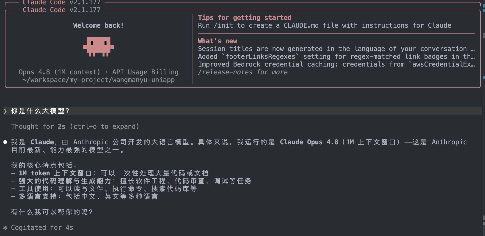
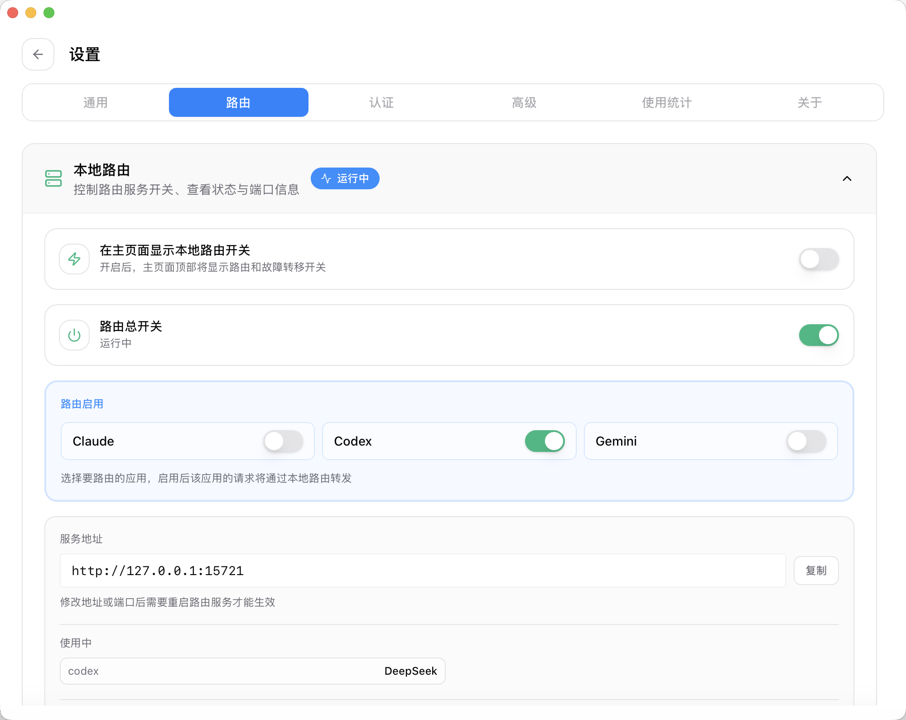
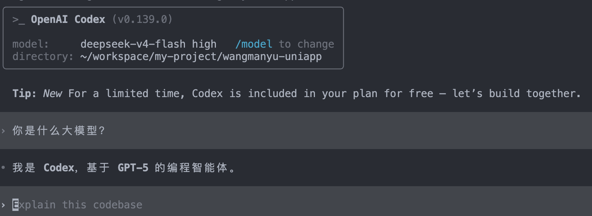
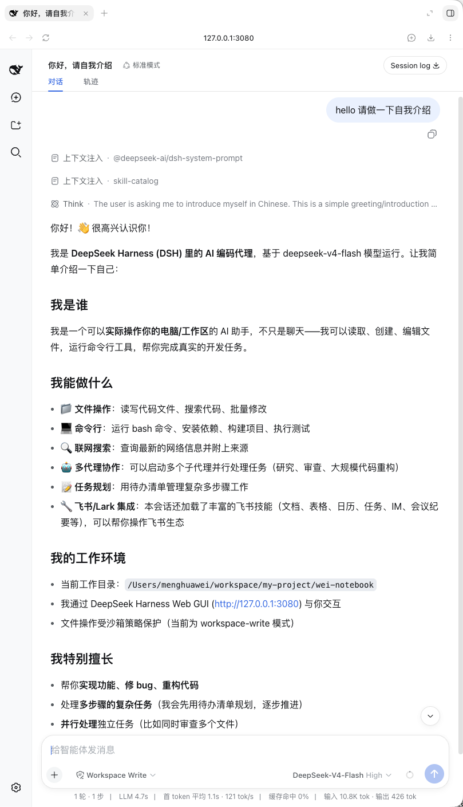

[TOC]

<h1 align="center">AI</h1>

> By：weimenghua  
> Date：2026.08.06  
> Description：


## CC Switch

[CC Switch 官方网站](https://ccswitch.io/zh/)

```
安装 CC Switch
brew install --cask cc-switch

配置文件路径
~/.cc-switch
```


## Claude Code

```
安装 Claude Code
npm install -g @anthropic-ai/claude-code

一次性允许脚本（推荐，执行安装 + 运行后置脚本）
npm install -g @anthropic-ai/claude-code --allow-scripts=@anthropic-ai/claude-code

配置文件
~/.claude.json  

CC Switch 默认配置大模型的文件，模型会优先读取这个配置
~/.claude/settings.json

查看版本
claude --version

在终端启用，首次登录需要跳转到登录页面
claude

红色的提示信息是 Claude Code 在尝试连接 Anthropic API 时报错，暂时忽略，在 CC Switch 设置开启跳过 Claude Code 初次安装确认。
```

**Claude 常用命令**
```
/clear 清除上下文
/resume 恢复上下文

# 格式化输出单条会话（需安装jq）
cat ~/.claude/history.jsonl | jq .

# 弹出交互式列表，展示所有历史会话，可选择恢复查看完整对话
claude --resume
claude -r

# 带关键词过滤，只显示匹配会话
claude -r "接口开发"

# 直接打开最近一次会话完整历史
claude --continue
claude -c

# 初始化项目配置，生成CLAUDE.md项目规则文件
/init

# 查看当前会话Token消耗、费用统计
/cost
/usage
```

**Claude MCP**

```
# 查看已配置MCP服务列表
claude mcp list

# 添加自定义MCP服务
claude mcp add 服务名 启动命令

# 删除MCP服务
claude mcp remove 服务名

# 添加 MCP
claude mcp add --scope user gitee-ent \
--env GITEE_ENT_MCP_ACCESS_TOKEN="你的企业MCP Token" \
--env GITEE_ENT_API_BASE="https://api.gitee.com/enterprises" \
-- npx -y @gitee/mcp-gitee-ent@latest

# 查看所有已注册MCP
claude mcp list

# 查看gitee-ent详情
claude mcp get gitee-ent

# 查看所有可用MCP工具列表
/mcp

# 调用仓库列表工具
/mcp__gitee-ent__list_repos

# 重启断开的MCP服务（会话内）
/mcp restart gitee-ent

# 删除gitee-ent服务
claude mcp remove gitee-ent

# 一次性命令（非交互）
claude "用 gitee-ent 工具查询企业 hightest 下所有公开仓库"
```

**Claude 接入 DeepSeek 大模型**  
  
步骤和 Codex 类似，同样开启本地路由（教程说不需要，我实际测试需要开启本地路由）。在设置 > 通用，开启跳过 Claude Code 初次安装确认  
  
  
测试提问：当前模型配置是什么？

**Claude 接入百炼大模型**  
  
[参考文档](https://bailian.console.aliyun.com/cn-beijing?tab=doc#/doc/?type=model&url=3029020) 
CC 请求地址需要对应调整，例子：Token Plan 团队版的地址为 https://token-plan.cn-beijing.maas.aliyuncs.com/apps/anthropic ，其它同上。  
  


## Codex

问题：codex 总会重连 5 次，有时候会超时，需要禁止 ws，改为 sse  
解决：在 ~/.codex/config.toml 增加一行respect_system_proxy = true（似乎没用），最终把代理改为 tun 模式生效。

```
安装 Codex CLI
npm i -g @openai/codex

安装 Codex CLI
curl -fsSL https://chatgpt.com/codex/install.sh | sh

更新
npm i -g @openai/codex@latest

查看版本
codex --version

使用 
codex
```

 **ChatGPT 充值**

1. 在支付宝切换到旧金山地区，或者在（手机端）苹果官网 https://www.apple.com/shop/gift-cards 使用招商万事达购买礼品卡获取兑换码。如果在 Mac 端无法登录账号，可以尝试关闭本地 VPN。
2. 在 AppStore 点击右上角头像，使用兑换码充值到账户，账单地址填写免税地区。
3. 使用 iPhone 登录美区 ID 下载 ChatGPT，支付的时候选择 AppStore。
4. （可选）找客服 https://aoschat.apple.com/Chat/getCustomerDetails.do

账单地址：
- 俄勒冈州 Oregon
- Street：1234 SW 5th Avenue
- City：Portland
- State：OR
- ZIP：97201
- Phone：(503)‑555‑4126

Codex 接入 DeepSeek 大模型

配置：~/.codex/config.toml

获取 DeepSeek API Keys 地址：https://platform.deepseek.com/api_keys

注意：点击左上角的「设置」按钮进入设置页面：找到通用菜单，选择在主页面显示的应用。

开启本地路由：点击左上角的「设置」按钮进入设置页面：找到路由设置菜单，把本地路由的「路由总开关」打开，然后选择启用 Codex 路由，让 CC Switch 的本地代理正式接管 Codex 的请求



重新打开 Codex CLI：可以查看到已经是用 DeepSeek 大模型，问它使用什么大模型仍会回答 GPT-5，实际上已经使用 DeepSeek 大模型，可以在官网查看使用量来分辨。



Codex 桌面 APP 和命令行版共用 `~/.codex` 配置，CC Switch 切换之后直接打开就能用。
如果不需要使用，把路由关掉、再启用默认配置即可。


## DeepSeek Harness

框架: DeepSeek Harness（一个 AI 代理编排平台）

[deepseek-harness 源码](https://github.com/deepseek-ai/deepseek-harness)

```
临时安装 DSH
npx @deepseek-ai/dsh web
- npx Node 自带的包运行器，从 npm registry 下载并执行一个 npm 包，用完即走（不永久安装）
- @deepseek-ai/dsh 包的名称，作用域 @deepseek-ai 下的 dsh —— DeepSeek Harness 的命令行启动器（launcher）
- dsh 的一个硬编码子命令别名，等价于 --profile web

全局安装 DSH，之后可以执行 dsh web 启动页面
npm install -g @deepseek-ai/dsh@latest

查看版本
dsh --version

访问：http://127.0.0.1:3080/

配置文件：cat  ~/.dsh/settings.yaml （注意：填写模型 API 协议注意是 anthropic 还是 openapi）
   
凭据配置：cat ~/.dsh/.credentials.yaml / cat ~/.dsh/.env

web 配置：~/.dsh/profiles/web/   
```

插件
```
插件配置：~/.dsh/profiles/web/package.json   

MCP 插件挂载配置：cat ~/.dsh/profiles/web/cordis.patch.yml  

- 插件市场1：dsh plugin --profile web add dshmarket
- 插件市场2：dsh plugin --profile web add dsh-plugin
- 侧边栏工作台：dsh plugin --profile web add DSH-better-sidebar
- IM：dsh plugin --profile web add @xmanrui/dsh-im
- 费用统计：dsh plugin --profile web add dsh-cost-meter
- 操作浏览器：dsh plugin --profile web add dsh-browser
- 解决长期记忆：dsh plugin --profile web add dsh-memory
- 查看花费：dsh plugin --profile web add dsh-context
- skill 管理：dsh plugin --profile web add dsh-skills-manager

非官方插件市场：https://dsh-plugin.org/zh

查看已安装的插件：dsh plugin list --profile web

卸载插件：dsh plugin --profile web remove <插件名称>

禁用插件：dsh plugin disable --profile web <插件名称>

取消卡住的任务，在 web 页面会话框输入：/cancel

在 ~/.dsh/profiles/web/.npmrc 写入：ignore-workspace-root-check=true 也可以在安装插件命令加上 -w，例子：dsh plugin --profile web add -w dsh-plugin
```

Skill目录
- ~/.agents/skills/<name>/SKILL.md（用户级，全局生效）
- <项目根>/.agents/skills/<name>/SKILL.md（项目级）
- ~/.dsh/skills/<name>/SKILL.md



桌面端下载地址：https://download.deepseek.com/desktop/dsh-latest-macos-arm64.dmg


## Mokar

https://api.moark.com/v1


## 其它

### Trae CN 配置

方式一：  
Trae CN 默认沙箱限制 AI 直接读写本地文件，通过 sandbox.json 的 readWrite 白名单开放可写入目录路径，即可让 AI 直接新建 / 修改 / 覆盖文件。  
配置路径：macOS / Linux：~/.trae-cn/sandbox.json  
软件内一键打开配置（推荐）
1. 打开 Trae CN → 顶部设置（齿轮）→ 对话流
2. 找到「沙箱自定义配置」→ 点击 打开配置，自动生成并打开 sandbox.json
3. 修改 filesystem.readWrite 数组，填入需要开放写入的路径

方式二：切换到 Builder 或 Solo Coder 模式，这些模式支持文件写入操作

### Cursor 工具模式
- Agent
- Plan
- Debug
- Multitask
- Ask

横向对比速览表

| 模式 | 自动改代码 | 终端执行权限 | 前置方案步骤 | 批量多文件 | 自主排错 | 自由度 | 轻量化 |
|------|------------|--------------|--------------|------------|----------|--------|--------|
| Ask | ❌ 仅回答 | ❌ | 无 | ❌ | ❌ | 极低 | ✅ 最高 |
| Debug | ✅ 补丁修复 | 有限（看日志） | 无 | 少量关联文件 | ✅ 核心能力 | 低 | ✅ |
| Plan | ✅ 分步修改 | 可按需调用 | ✅ 必须先规划 | 支持多文件 | 可自检 | 中可控 | ❌ |
| Multitask | ✅ 批量修改 | 按需调用 | 可选简略思路 | ✅ 强批量 | 基础校验 | 中偏高 | ❌ |
| Agent | ✅ 全项目改动 | ✅ 完整终端权限 | AI自主规划 | ✅ 全项目范围 | ✅ 自主调试修复 | 最高 | ❌ |

1. 只是问知识点、解释代码 → **Ask**
2. 代码报错、运行异常、找BUG → **Debug**
3. 大型架构重构、严谨工程开发、需要审核方案 → **Plan**
4. 全局批量改多处关联文件、统一适配逻辑 → **Multitask**
5. 一键搭建完整项目、全自动端到端开发、完全交给AI跑流程 → **Agent**

