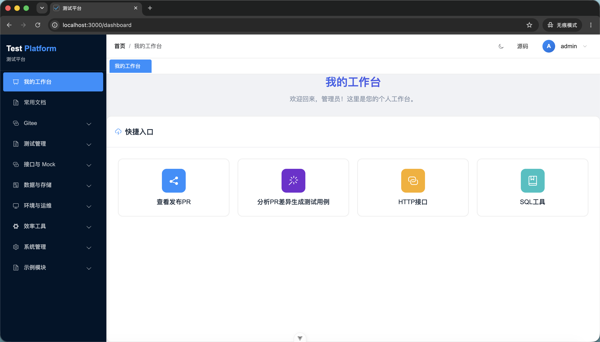
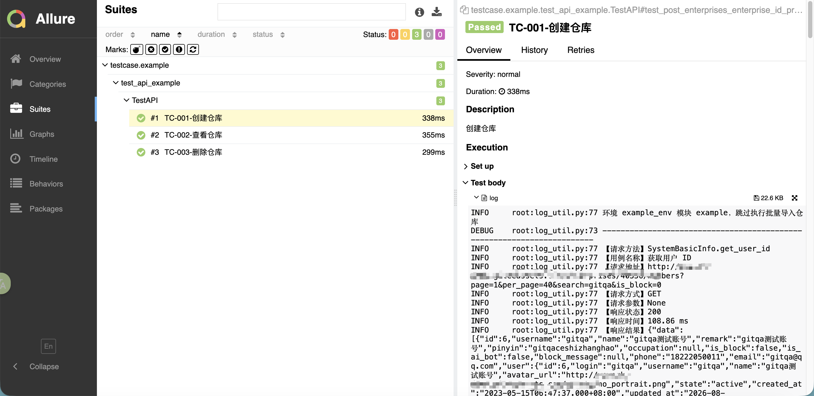
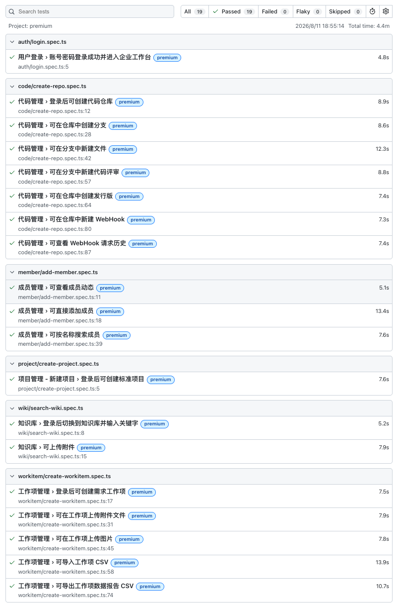
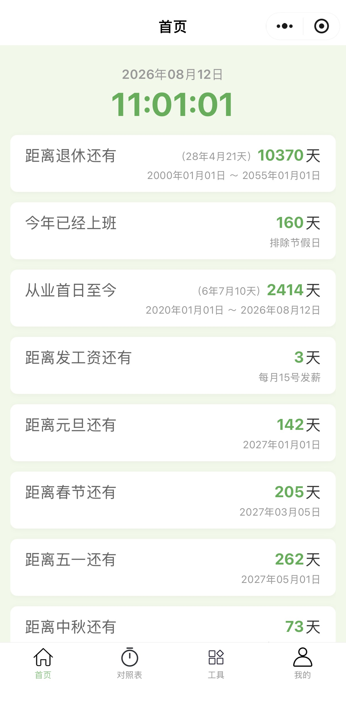
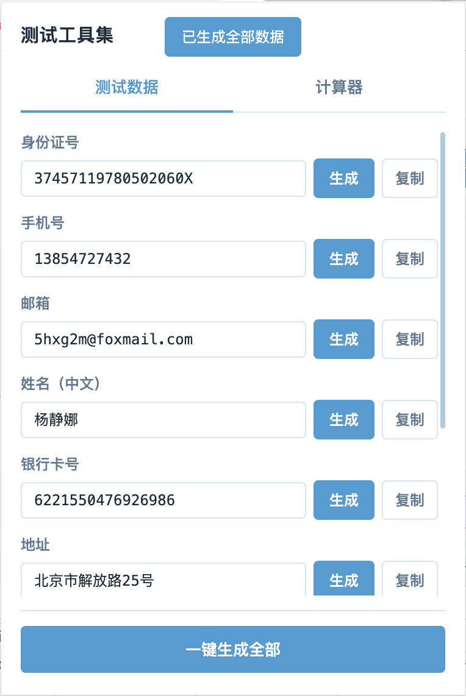
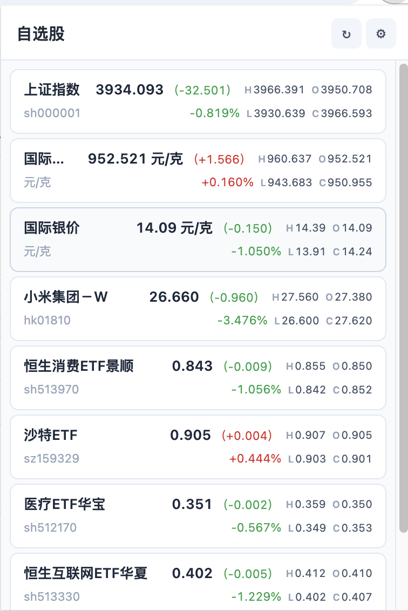
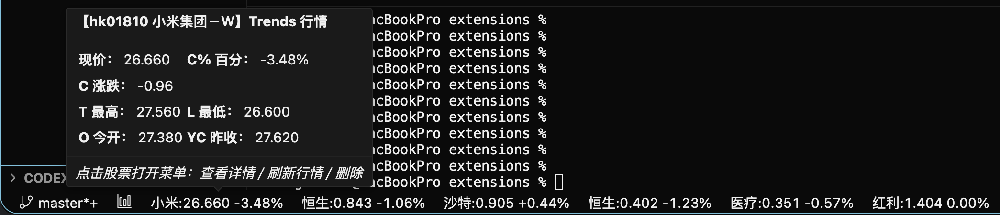
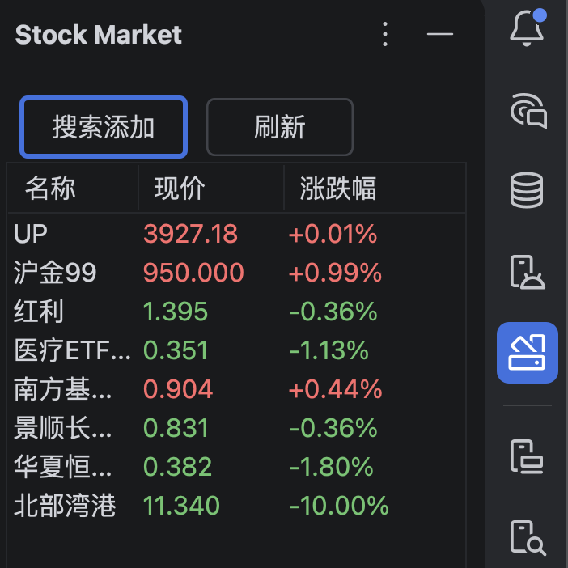

## 测试平台

简介：[test-platform](https://github.com/iewiewiew/test-platform) 面向 QA / 测试 / 开发的综合效能平台：集成 Gitee 发布流与 AI 用例生成、接口 Mock、数据库工具、自动化测试、环境运维与效率工具。
技术栈： Flask + Vue 3 + MySQL。

## API自动化测试项目

简介：[api-autotest](https://gitee.com/iewiewiew/api-autotest) 基于 Python Pytest 实现的 Web API 接口自动化测试项目。  
技术栈：Pytest + Pytest。

## UI自动化测试项目

简介：[ui-autotest](https://gitee.com/iewiewiew/ui-autotest) 支持 Gitee Premium 项目管理平台仓库管理、工作项管理 UI 测试。  
技术栈：Playwright + TypeScript（POM）。

## 微信小程序

简介：[all-countdown](https://github.com/iewiewiew/all-countdown) 展示多种事件倒计时。  
技术栈：uni-app（Vite）+ Vue 3 + SCSS。

## 插件集合

[extensions](https://github.com/iewiewiew/extensions)

### Chrome 测试工具集插件

简介：测试数据生成：身份证、手机号、邮箱、姓名、银行卡、地址、UUID、日期时间、随机字符串；计算机。  
技术栈：html + css + js。

### Chrome 查看股票行情插件

简介：点击浏览器工具栏图标，查看自选股实时行情，交易时段每 5 秒自动刷新；贵金属自选股全天刷新。  
技术栈：html + css + js。

### Vscode 查看股票行情插件

简介：支持查看股票行情，实时刷新最新行情。  
技术栈：TypeScript + VSCode Extension API + Chart.js。

### IDEA 查看股票行情插件

简介：支持查看股票行情，实时刷新最新行情。  
技术栈：Kotlin + IntelliJ Platform SDK。  

