# Mermaid v11.16.1 Flowchart 完整语法参考

> 官方文档：https://mermaid.js.org/syntax/flowchart.html  
> 在线体验：https://mermaid.live/

---

## 目录

- [1. 方向声明](#1-方向声明)
- [2. 节点形状](#2-节点形状)
  - [2.1 基础形状](#21-基础形状)
  - [2.2 v11.3.0+ 新增 30+ 形状（新语法）](#22-v1130-新增-30-形状新语法)
- [3. 节点文本格式](#3-节点文本格式)
- [4. 连接线 / 边](#4-连接线--边)
  - [4.1 连接线类型](#41-连接线类型)
  - [4.2 多方向箭头](#42-多方向箭头)
  - [4.3 指定连接长度](#43-指定连接长度)
  - [4.4 边 ID 与动画（v11+）](#44-边-id-与动画v11)
- [5. 子图（Subgraph）](#5-子图subgraph)
- [6. 样式与类](#6-样式与类)
- [7. 交互](#7-交互)
- [8. 完整示例](#8-完整示例)

---

## 0. 版本

```mermaid
  info
```

## 1. 方向声明

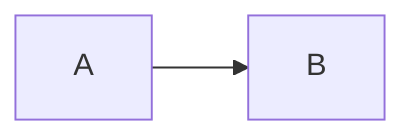

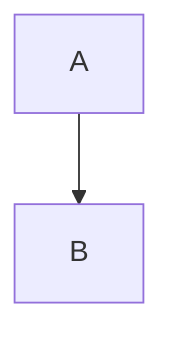

| 方向 | 说明 |
|------|------|
| `TB` | 从上到下（Top to Bottom） |
| `TD` | 同 TB（Top Down） |
| `BT` | 从下到上（Bottom to Top） |
| `RL` | 从右到左（Right to Left） |
| `LR` | 从左到右（Left to Right） |

> 提示：`flowchart` 也可以使用 `graph` 替代，推荐使用 `flowchart`。

---

## 2. 节点形状

### 2.1 基础形状

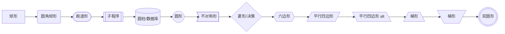

| 语法 | 形状 | 说明 |
|------|------|------|
| `A[text]` | 矩形 | 默认节点 |
| `A(text)` | 圆角矩形 | 圆角框 |
| `A([text])` | 跑道形 | Stadium / 胶囊 |
| `A[[text]]` | 子程序 | Subroutine |
| `A[(text)]` | 圆柱形 | Database / 存储 |
| `A((text))` | 圆形 | Circle |
| `A>text]` | 不对称形 | Asymmetric |
| `A{text}` | 菱形 | Decision / 决策 |
| `A{{text}}` | 六边形 | Hexagon |
| `A[/text/]` | 平行四边形 | Parallelogram |
| `A[\text\]` | 平行四边形 alt | Parallelogram alt |
| `A[/text\]` | 梯形 | Trapezoid |
| `A[\text/]` | 梯形 alt | Trapezoid alt |
| `A(((text)))` | 双圆形 | Double circle |

### 2.2 v11.3.0+ 新增 30+ 形状（新语法）

使用 `A@{ shape: xxx }` 语法定义：

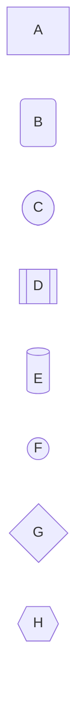

#### 完整列表

| 语义名 | Shape 名 | 别名 | 描述 |
|--------|----------|------|------|
| Bang | `bang` | bang | 感叹号形状 |
| Browser | `browser` | browser | 浏览器窗口 |
| Bucket | `bucket` | bucket | 对象存储桶 |
| Card | `notch-rect` | card, notched-rectangle | 卡片 |
| Cloud | `cloud` | cloud | 云状 |
| Collate | `hourglass` | collate, hourglass | 沙漏（归并操作） |
| Com Link | `bolt` | com-link, lightning-bolt | 闪电（通信链路） |
| Comment | `brace` | brace-l, comment | 左花括号（注释） |
| Comment Right | `brace-r` | - | 右花括号 |
| Comment Both | `braces` | - | 双花括号 |
| Console | `console` | console | 终端窗口 |
| Data In/Out | `lean-r` | in-out, lean-right | 数据输入/输出 |
| Data Out/In | `lean-l` | out-in, lean-left | 数据输出/输入 |
| Data Store | `datastore` | data-store | 数据存储 |
| Database | `cylinder` | cylinder, database, db | 数据库 |
| Decision | `diamond` | decision, diamond, question | 决策 |
| Delay | `delay` | half-rounded-rectangle | 延迟 |
| Direct Access | `h-cyl` | das, horizontal-cylinder | 直接访问存储 |
| Disk | `lin-cyl` | disk, lined-cylinder | 磁盘存储 |
| Display | `curv-trap` | curved-trapezoid, display | 显示器 |
| Divided Process | `div-rect` | div-proc, divided-process, divided-rectangle | 分割过程 |
| Document | `doc` | doc, document | 文档 |
| Event | `rounded` | event | 圆角矩形（事件） |
| Extract | `triangle` | extract, triangle | 三角形（提取） |
| Folder | `folder` | directory, folder | 文件夹 |
| Fork/Join | `fork` | fork, join | 填充矩形（分支/合并） |
| Internal Storage | `win-pane` | internal-storage, window-pane | 窗格（内部存储） |
| Junction | `f-circ` | filled-circle, junction | 实心圆（连接点） |
| Lined Document | `lin-doc` | lined-document | 带线文档 |
| Lined Process | `lin-rect` | lin-proc, lined-process, shaded-process | 带线矩形 |
| Loop Limit | `notch-pent` | loop-limit, notched-pentagon | 循环限制 |
| Manual File | `flip-tri` | flipped-triangle, manual-file | 翻转三角形（手动文件） |
| Manual Input | `sl-rect` | manual-input, sloped-rectangle | 斜矩形（手动输入） |
| Manual Operation | `trap-t` | inv-trapezoid, manual, trapezoid-top | 倒梯形（手动操作） |
| Multi-Document | `docs` | documents, st-doc, stacked-document | 多文档 |
| Multi-Process | `st-rect` | processes, procs, stacked-rectangle | 多进程 |
| Odd | `odd` | odd | 奇形 |
| Paper Tape | `flag` | paper-tape | 纸带 |
| Person | `person` | person | 人物 |
| Prepare | `hexagon` | hexagon, prepare | 六边形（准备条件） |
| Priority Action | `trap-b` | priority, trapezoid, trapezoid-bottom | 梯形（优先级） |
| Process | `rect` | proc, process, rectangle | 矩形（标准过程） |
| Start | `circle` | circ, start | 圆形（起点） |
| Small Start | `sm-circ` | small-circle, start | 小圆形（起点） |
| Stop | `dbl-circ` | double-circle, stop | 双圆形（停止） |
| Stop (Framed) | `fr-circ` | framed-circle, stop | 带框圆形（停止） |
| Stored Data | `bow-rect` | bow-tie-rectangle, stored-data | 蝶结矩形（存储数据） |
| Subprocess | `fr-rect` | framed-rectangle, subproc, subprocess, subroutine | 带框矩形（子过程） |
| Summary | `cross-circ` | crossed-circle, summary | 十字圆形（汇总） |
| Tagged Document | `tag-doc` | tag-doc, tagged-document | 带标签文档 |

**示例：**

```mermaid
flowchart LR
  A@{ shape: rect, label: "Process" }
  B@{ shape: database, label: "DB" }
  C@{ shape: cloud, label: "Cloud" }
  D@{ shape: person, label: "User" }
  E@{ shape: document, label: "Doc" }
  F@{ shape: hourglass, label: "Collate" }
  G@{ shape: braces, label: "Comment" }
  A --> B --> C
  B --> D
  C --> E
  A --> F --> G
```

---

## 3. 节点文本格式

**Unicode 文本：** 使用双引号包裹

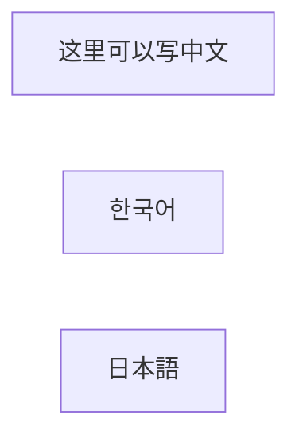

**Markdown 格式：** 使用双引号 + 反引号

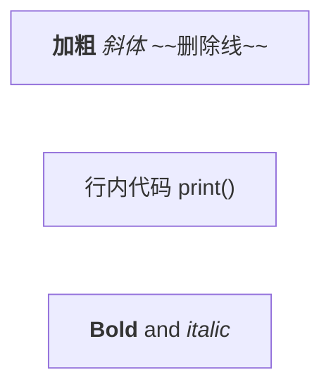

---

## 4. 连接线 / 边

### 4.1 连接线类型

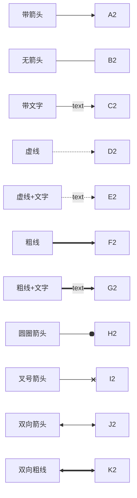

| 语法 | 类型 |
|------|------|
| `A-->B` | 带箭头 |
| `A---B` | 无箭头 |
| `A--text---B` | 带文字、无箭头 |
| `A--text-->B` | 带文字、带箭头 |
| `A-.-B` | 虚线、无箭头 |
| `A-.->B` | 虚线、带箭头 |
| `A-.text.-B` | 虚线、带文字、无箭头 |
| `A-.text.->B` | 虚线、带文字、带箭头 |
| `A===B` | 粗线、无箭头 |
| `A==>B` | 粗线、带箭头 |
| `A==text===B` | 粗线、带文字、无箭头 |
| `A==text==>B` | 粗线、带文字、带箭头 |
| `A--oB` | 圆圈箭头 |
| `A--xB` | 叉号箭头 |
| `A<-->B` | 双向箭头 |
| `A<==>B` | 双向粗箭头 |
| `A~~~B` | 隐形连接（影响布局但不显示） |

### 4.2 多方向箭头

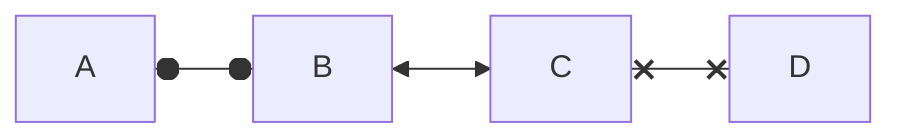

### 4.3 指定连接长度

通过增加破折号（`-`）、等号（`=`）或点号（`.`）来指定连接线跨越更多层级：

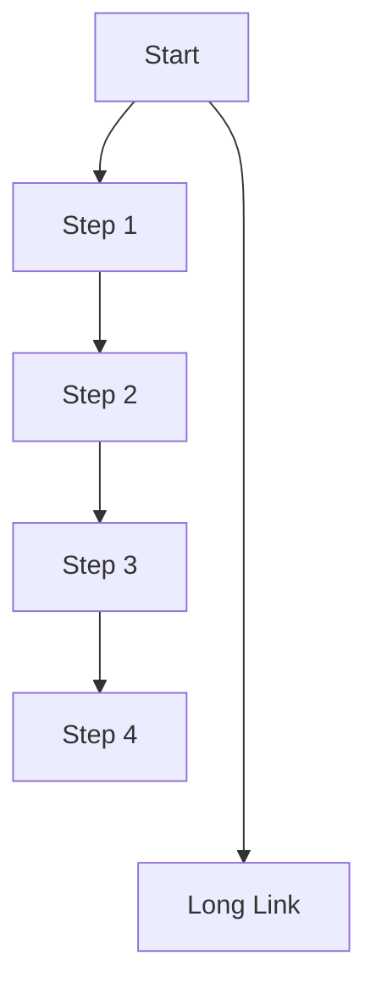

| 长度标记 | 带箭头 | 粗箭头 | 虚箭头 |
|----------|--------|--------|--------|
| 1 段 | `-->` | `==>` | `-.->` |
| 2 段 | `--->` | `===>` | 多加点 |
| 长 | `----->` | `====>` | 多加点 |

### 4.4 边 ID 与动画（v11+）

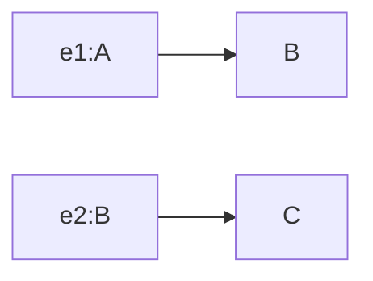

---

## 5. 子图（Subgraph）

### 基础子图

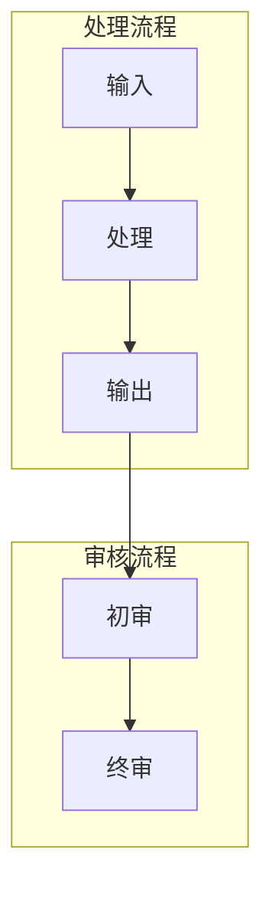

### 可折叠子图（v11+）

```mermaid
flowchart TB
  subgraph id["详细处理"]:::collapsible
    direction TB
    A --> B --> C --> D
  end
  E[开始] --> A
  D --> F[结束]
```

### 子图间连接

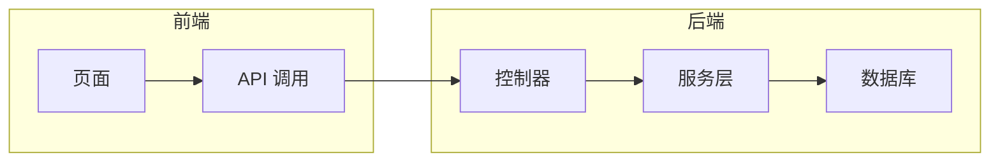

---

## 6. 样式与类

### 行内样式


### classDef 定义类

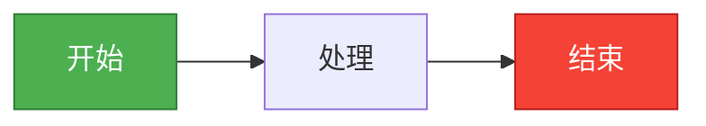

### 多节点应用类

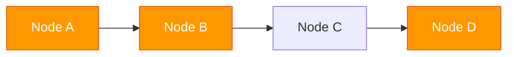

---

## 7. 交互

### 链接跳转


### 回调函数

> 注意：回调函数仅在 HTML 页面中有效，Obsidian 中不支持。

```html
<script>
  function callback(nodeId) {
    alert('点击了节点：' + nodeId);
  }
</script>
```

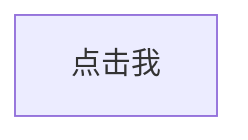

### 打开链接方式

```mermaid
flowchart LR
  A[当前窗口打开] --> B[新窗口打开]
  click A href "https://example.com" "当前窗口"
  click B href "https://example.com" "新窗口" _blank
```

---

## 8. 完整示例

### 微服务架构图

```mermaid
flowchart TB
  subgraph client[客户端层]
    direction LR
    web[Web App] --> mobile[Mobile App]
  end

  subgraph gateway[网关层]
    LB[负载均衡] --> API[API Gateway]
  end

  subgraph services[服务层]
    direction LR
    user[用户服务] --> order[订单服务]
    order --> payment[支付服务]
    payment --> notify[通知服务]
  end

  subgraph storage[存储层]
    DB[(MySQL)]
    Cache[(Redis)]
    MQ[消息队列]
  end

  client -->|HTTPS| gateway
  gateway --> services
  services --> storage

  style DB fill:#1565C0,stroke:#0D47A1,color:#fff
  style Cache fill:#E65100,stroke:#BF360C,color:#fff
  style MQ fill:#2E7D32,stroke:#1B5E20,color:#fff
```

### 带新形状的 CI/CD 流程图

```mermaid
flowchart LR
  Code@{ shape: doc, label: "源代码" }
  Build@{ shape: console, label: "构建" }
  Test@{ shape: diamond, label: "测试" }
  Artifact@{ shape: cylinder, label: "制品库" }
  Deploy@{ shape: cloud, label: "部署" }
  Monitor@{ shape: browser, label: "监控" }

  Code --> Build --> Test
  Test -->|通过| Artifact
  Test -->|失败| Code
  Artifact --> Deploy
  Deploy --> Monitor
```

### 带动画的流程图

```mermaid
flowchart LR
  e1:Start --> e2:Step1
  e2 --> e3:Step2
  e3 --> e4:End
  classDef animate stroke-dasharray: 5 5, stroke: #ff6f00
  class e1,e2,e3,e4 animate
```

---

> **参考：**
> - [Mermaid 官方文档](https://mermaid.js.org/syntax/flowchart.html)
> - [Mermaid 在线编辑器](https://mermaid.live/)
> - [Mermaid 中文网](https://mermaid.nodejs.cn/)